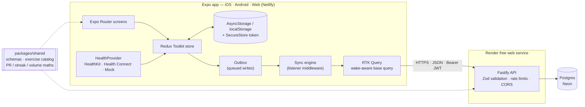
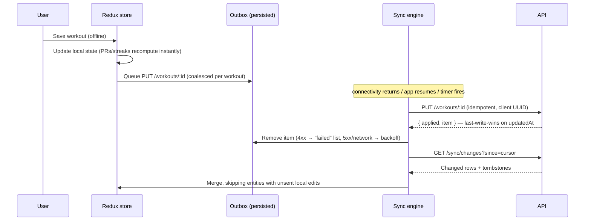

# FitTrack

[](https://github.com/Isaacpyo/FitTrack/actions/workflows/ci.yml)

**FitTrack is an offline-first workout tracker for people who train where the signal dies.**
Log sets, reps and weight in seconds (prefilled from last session), save reusable routines,
and watch your personal records, strength curve, weekly volume and streaks update instantly.
Each change is saved on the device first and synced to a Node/Postgres API in the background,
so a basement gym never costs you a workout. On iOS and Android development builds it also
reads steps and activity from Apple Health or Health Connect. It is one Expo codebase that
ships to iOS, Android and the web.

**Live demo: <https://fittrack.temitopeagbola.com>**. Click **Try the demo** to get a private
sandbox account with 10 weeks of training history. The API runs on a free Render instance that
sleeps when idle, so the first request can take up to a minute. The app shows a "Waking the
server…" banner while it starts.


## Features

- **Workout logging.** Track exercises, sets, reps and weight against a 36-exercise catalog with
  search and muscle-group filters. Sets are prefilled from the last time you did the exercise,
  with "last time" hints. Drafts are persisted, so an in-progress workout survives the app closing.
- **Reusable routines.** Build Push / Pull / Legs-style templates with target sets, reps and
  weight, and start one with a single tap.
- **Personal records.** Heaviest weight, estimated 1RM (Epley), best set volume and rep records
  for bodyweight moves. New PRs are highlighted when you save and appear as badges in history.
- **Progress charts.** Estimated 1RM per session for any exercise, 12 weeks of training volume,
  and 14 days of steps against your goal. Each chart has press/hover/keyboard readouts and a
  data-table view.
- **Streaks.** An active-day streak (a workout, or your step goal reached) and a weekly
  workout-goal streak.
- **Health sync.** Apple Health (HealthKit) on iOS and Health Connect on Android, in
  development builds. The web and Expo Go use a simulated provider, as described in
  [Stack decisions](#stack-decisions-and-substitutions).
- **Offline-first sync.** A persisted outbox with per-entity coalescing, ordered replay,
  exponential backoff, last-write-wins conflict handling and incremental pulls with
  tombstones. Offline status, pending changes and failed changes are all visible in the UI.
- **Accounts.** Email/password sign-up and sign-in, plus a one-click demo. Expired sessions keep
  unsynced work until you sign back in. Sign-out and account deletion are available in Settings.
- **Product polish.** Loading, empty and error states everywhere. The layout is responsive down
  to 375px, and controls have accessible labels and visible focus rings. A "waking server"
  banner covers the free-tier cold start.

## Architecture



How a write travels when you are offline:



There is more detail, including the data model, sync protocol and trade-offs, in
[`docs/PLAN.md`](docs/PLAN.md).

## Tech stack

| Layer    | Choice                                                                                  |
| -------- | --------------------------------------------------------------------------------------- |
| App      | Expo SDK 57, Expo Router, React Native 0.86, react-native-web, TypeScript (strict)      |
| State    | Redux Toolkit (slices, entity adapters, listener middleware) and RTK Query              |
| Charts   | Small in-house SVG line/bar charts on `react-native-svg`                                |
| Health   | `@kingstinct/react-native-healthkit`, `react-native-health-connect`, simulated provider |
| API      | Node 22, Fastify 5, Zod, `@fastify/jwt`, `@fastify/rate-limit`, `@fastify/helmet`, `pg` |
| Database | Postgres 17 (Docker locally, Neon in production)                                        |
| Tests    | Vitest (unit + API integration against real Postgres), Playwright (e2e)                 |
| Tooling  | npm workspaces, ESLint, Prettier, tsup, Docker, GitHub Actions                          |
| Hosting  | Netlify (web), Render free web service (API), Neon free Postgres                        |

## Stack decisions and substitutions

- **The web build uses a mocked health-data provider.** This is the one requested swap.
  Browsers have no API for Apple Health or Health Connect, and Expo Go cannot load custom native
  modules. So on the web, in Expo Go, or when `EXPO_PUBLIC_HEALTH_PROVIDER=mock` is set, FitTrack
  reads simulated daily steps, active minutes and energy instead. The data is deterministic per
  date, and it comes from the same generator the demo seed uses, so the numbers match what the
  server already holds. In an iOS or Android **development build** (`npx expo run:ios`,
  `npx expo run:android` or EAS), the app loads the real HealthKit or Health Connect provider and
  asks for read-only permission. Native modules are loaded lazily, so the web and Expo Go never
  import them.
- **No chart library.** The project brief didn't name one, and Victory Native XL needs Skia
  (CanvasKit WASM on the web). Three small SVG components keep the web bundle lean and render the
  same on every platform. Their colours were checked with a palette validator for the dark theme.
- **Fastify** was chosen for the "Node.js API" because it is fast, has typed plugins and makes
  request injection easy for tests. The SQL is hand-written with `pg`: workout sets are
  normalised for analytics, and routine templates are stored as Zod-validated JSONB.
- **Passwords** are hashed with `node:crypto` scrypt, which avoids native dependencies on
  Render's build image.
- **Offline-first design.** IDs are generated on the client, so records can be created offline
  and retries are idempotent. Stats are computed on the client from local data with the shared
  pure functions, so they work offline and include unsynced workouts.
- **Demo accounts are per visitor.** Each "Try the demo" creates its own sandbox, seeded
  relative to the visitor's date, so streaks and charts always look current. Sandboxes are
  purged after 24 h. Redis and Mongo aren't part of this stack and aren't used.

## Getting started

Prerequisites: Node 22+, npm 10+ and Docker.

### Option A: the whole stack in Docker

```bash
docker compose up --build             # Postgres + API (:4000) + web (:8080)
docker compose run --rm seed          # optional: demo@fittrack.dev / demo-password
```

Open <http://localhost:8080> and click **Try the demo**.

### Option B: dev servers with hot reload

```bash
npm ci
docker compose up -d db               # Postgres on :5432 (also creates the test databases)
cp .env.example .env                  # defaults work locally
npm run dev:api                       # API on http://localhost:4000 (migrates on start)
npm run db:seed                       # optional fixed account
npm run dev:web                       # Expo dev server; press "w" for the browser
```

### Run it on your phone

- **Expo Go** (quickest, uses simulated health data): run `npm run dev:web` and scan the QR code
  it prints with the Expo Go app (Android) or the Camera app (iOS). Point the app at your
  computer with `EXPO_PUBLIC_API_URL=http://<your-LAN-IP>:4000` in `apps/web/.env`.
- **Development build** (real Apple Health / Health Connect): in `apps/web`, run
  `npx expo run:ios` or `npx expo run:android`. Or build in the cloud with
  `eas build --profile development`, which needs a free Expo account. HealthKit also needs an
  Apple developer team for signing.

## Testing

| What                       | Command                                                     | Notes                                                       |
| -------------------------- | ----------------------------------------------------------- | ----------------------------------------------------------- |
| Everything except e2e      | `npm test`                                                  | Needs Postgres (`docker compose up -d db`)                  |
| Shared logic (59 tests)    | `npm test -w @fittrack/shared`                              | PRs, streaks, volume, schemas, demo data                    |
| API integration (29 tests) | `npm test -w @fittrack/api`                                 | Real Postgres; auth, ownership, last-write-wins, sync, demo |
| App logic (39 tests)       | `npm test -w @fittrack/web`                                 | Outbox, sync engine against a fake API, persistence, health |
| E2E smoke (Playwright)     | `npx playwright install chromium && npm run test:e2e`       | Demo → PR → offline logging → reconnect → server check      |
| Lint / types / format      | `npm run lint && npm run typecheck && npm run format:check` |                                                             |

CI (GitHub Actions) runs all of these on every push and pull request, and also builds the
Docker images.

## Deployment

The web app deploys to Netlify, the API to Render and the database to Neon, all on free tiers.

1. **Neon (Postgres).** Create a project and a database named `fittrack`. Copy the **pooled**
   connection string (it ends in `?sslmode=require`).
2. **Render (API).** Go to **New → Blueprint**, select this repo, and Render reads
   [`render.yaml`](render.yaml). Paste the Neon string into `DATABASE_URL`. `JWT_SECRET` is
   generated for you. Check that `CORS_ORIGINS` includes `https://fittrack.temitopeagbola.com`
   (and your Netlify deploy-preview pattern, if you use previews). Migrations run on every boot.
   Then visit `https://<service>.onrender.com/healthz`, which should return `{"ok":true,"db":"up"}`.
3. **Netlify (web).** The existing site already uses this repo and
   [`netlify.toml`](netlify.toml), which builds `apps/web` with `npm run build` and publishes
   `apps/web/dist`. Add the site environment variable
   `EXPO_PUBLIC_API_URL=https://<service>.onrender.com`. The build deliberately fails without
   it, so a deploy can never point at localhost. Merging to `main` deploys.
4. **Smoke check.** Open <https://fittrack.temitopeagbola.com>, click **Try the demo**, log a
   workout, then reload. It should still be there.

## Environment variables

Every variable is listed with comments in [`.env.example`](.env.example).

| Variable                                                                          | Where       | Purpose                                                                 |
| --------------------------------------------------------------------------------- | ----------- | ----------------------------------------------------------------------- |
| `DATABASE_URL`                                                                    | API         | Postgres connection string (Neon pooled URL in production)              |
| `JWT_SECRET`                                                                      | API         | Token signing secret; required (32+ characters) in production           |
| `JWT_EXPIRES_IN`                                                                  | API         | Session lifetime, default `30d`                                         |
| `CORS_ORIGINS`                                                                    | API         | Comma-separated browser origins; supports `https://*--site.netlify.app` |
| `NODE_ENV`, `HOST`, `PORT`, `LOG_LEVEL`                                           | API         | Runtime basics (Render sets `PORT`)                                     |
| `DATABASE_POOL_MAX`                                                               | API         | Postgres pool size (default 5)                                          |
| `RUN_MIGRATIONS`                                                                  | API         | Apply migrations on boot (default `true`)                               |
| `DEMO_TTL_HOURS`                                                                  | API         | Lifetime of demo sandboxes (default 24)                                 |
| `RATE_LIMIT_PER_MINUTE`, `AUTH_RATE_LIMIT_PER_MINUTE`, `DEMO_RATE_LIMIT_PER_HOUR` | API         | Per-IP rate limits                                                      |
| `TEST_DATABASE_URL`, `E2E_DATABASE_URL`                                           | Tests       | Databases for the integration and e2e suites                            |
| `EXPO_PUBLIC_API_URL`                                                             | App (build) | API base URL, inlined at build time; **required on Netlify**            |
| `EXPO_PUBLIC_HEALTH_PROVIDER`                                                     | App (build) | `mock` forces simulated health data on native                           |

## Project structure

```
apps/
  api/               Fastify API: routes, repos (SQL), migrations, demo seeding, tests
  web/               Expo app: src/app (routes), src/store (Redux + sync engine),
                     src/health (providers), src/components (UI + charts), tests
packages/
  shared/            Zod schemas, exercise catalog, PR/streak/volume maths, demo data
e2e/                 Playwright smoke tests + static server for the web export
docker/              Postgres init script, nginx config
docs/PLAN.md         Architecture plan, sync protocol, trade-offs
docker-compose.yml   Whole stack locally
render.yaml          Render blueprint (API)
netlify.toml         Netlify build for apps/web
```

## Security notes

- Passwords use scrypt with a per-user salt and timing-safe comparison. Unknown emails take
  as long to reject as wrong passwords.
- All input is validated with Zod at the API boundary, using the same schemas the app uses.
  SQL is fully parameterised.
- Ownership is enforced on every write. Reusing another user's workout ID returns 404 and
  never overwrites their data.
- Auth, demo creation and global traffic are rate limited per IP. CORS is an allow-list.
  Helmet sets security headers, and Netlify adds frame and content-type protections.
- Session tokens are stored in the Keychain/Keystore on devices (via SecureStore). On the web
  they go in `localStorage`, the usual trade-off for a bearer-token SPA, mitigated by strict
  CORS and token expiry.

## Known limitations and next steps

- Access tokens only (30 days); no refresh-token rotation or server-side revocation yet.
- On the first sync, the client downloads all history. Very long histories would need paging.
- Weights are in kg only; there is no unit preference yet.
- The HealthKit and Health Connect providers typecheck against the libraries' APIs but need a
  physical-device pass in a development build. CI only covers the simulated provider.
- Stats are computed on the client. A server-side stats endpoint would help other clients.
