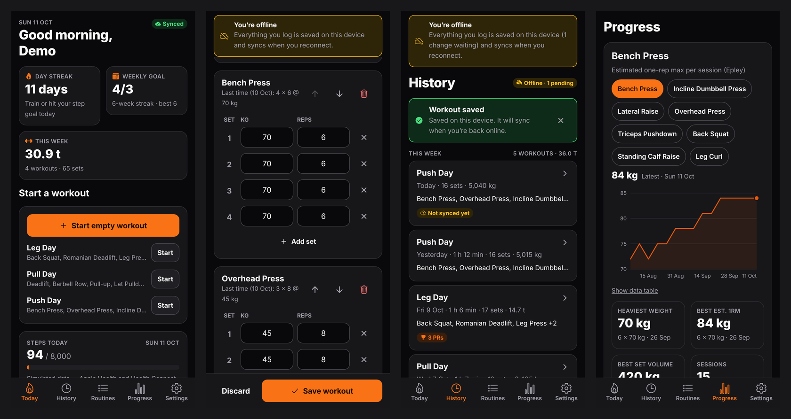
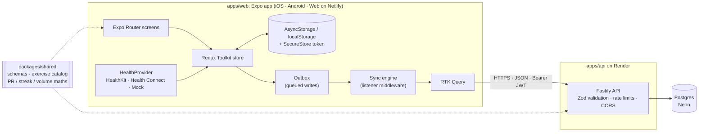
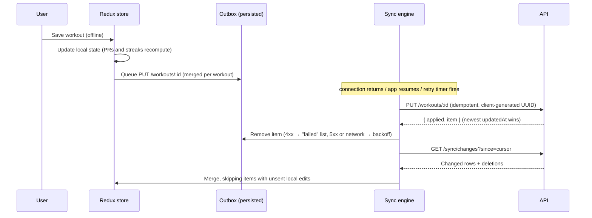

# FitTrack

[](https://github.com/temitopeagbola/FitTrack/actions/workflows/ci.yml)

An offline-first workout tracker for people who lift and want to log every set, even in a gym
with no signal. It runs on iOS, Android and the web from one Expo codebase.

## Overview

Losing a workout because the gym has no signal is frustrating, and so is waiting on a spinner
between sets. FitTrack saves everything on the device first. Workouts, routines and health data
are written to local state and a persisted outbox, then a background sync engine replays them
against a Node.js + Postgres API whenever a connection is available. Personal records, streaks
and charts are calculated on the device from the same shared code the API uses, so they work
offline and include workouts that haven't synced yet. On iOS and Android development builds, the
app also reads daily steps and activity from Apple Health or Health Connect.

Production URL (Netlify, see [Deployment](#deployment)): <https://fittrack.temitopeagbola.com>



## Key features

- **Workout logging.** Log exercises, sets, reps and weight from a 36-exercise catalog with search
  and muscle-group filters. Sets are prefilled from the last time you did the exercise. In-progress
  workouts are kept as a draft, so closing the app doesn't lose them.
- **Reusable routines.** Templates with target sets, reps and weight that start a workout in one
  tap.
- **Personal records.** Heaviest weight, estimated 1RM (Epley), best set volume, and rep records
  for bodyweight exercises. New PRs are shown when you save and as badges in history.
- **Progress charts.** Estimated 1RM per session for each exercise, weekly volume for the last 12
  weeks, and daily steps for the last 14 days against your goal. Every chart has a data-table view.
- **Streaks.** An active-day streak (a workout, or your step goal met) and a weekly workout-goal
  streak.
- **Health data.** Reads steps, active energy and exercise minutes from Apple Health (iOS) or
  Health Connect (Android) in development builds. The web and Expo Go use a simulated provider
  (see [Health data on the web](#health-data-on-the-web)).
- **Offline-first sync.** A persisted outbox merges edits to the same item and replays them in
  order, retries with exponential backoff, keeps the newest edit when two devices conflict, and
  pulls changes (including deletions) incrementally. Offline status and pending or failed changes
  are shown in the UI.
- **Accounts.** Email/password sign-up and sign-in, plus a one-click **Try the demo** that creates
  a private sandbox with 10 weeks of training history. Expired sessions keep unsynced work until
  you sign in again. Settings covers profile and goals, sign-out and account deletion.
- **Free-tier friendly.** A "Waking the server…" banner appears while the sleeping Render instance
  starts up.

## Tech stack

| Layer    | Choice                                                                                     |
| -------- | ------------------------------------------------------------------------------------------ |
| App      | Expo SDK 57, Expo Router, React Native 0.86, react-native-web, TypeScript (strict)         |
| State    | Redux Toolkit (slices, entity adapters, listener middleware) and RTK Query                 |
| Charts   | In-house SVG line and bar charts on `react-native-svg`                                     |
| Health   | `@kingstinct/react-native-healthkit` (iOS), `react-native-health-connect` (Android), mock  |
| API      | Node.js 22, Fastify 5, Zod, `@fastify/jwt`, `@fastify/rate-limit`, `@fastify/helmet`, `pg` |
| Database | PostgreSQL 17 (Docker locally, Neon in production)                                         |
| Auth     | Email + password (scrypt via `node:crypto`), JWT bearer tokens                             |
| Tests    | Vitest (unit, and API integration against real Postgres), Playwright (end-to-end)          |
| Tooling  | npm workspaces, ESLint, Prettier, tsup, Docker Compose, GitHub Actions                     |
| Hosting  | Netlify (web export), Render free web service (API), Neon (Postgres)                       |

## Architecture



How a write travels when you are offline:



[`docs/PLAN.md`](docs/PLAN.md) covers the sync protocol and trade-offs in more depth.

### API

| Method & path                               | Auth | Purpose                                                  |
| ------------------------------------------- | ---- | -------------------------------------------------------- |
| `GET /healthz`                              | No   | Liveness and database check                              |
| `GET /exercises`                            | No   | Exercise catalog                                         |
| `POST /auth/signup`, `POST /auth/login`     | No   | Create an account or sign in; returns a JWT and the user |
| `POST /auth/demo`                           | No   | Create a seeded demo sandbox account                     |
| `GET /me`, `PATCH /me`, `DELETE /me`        | Yes  | Profile and goals; delete the account and its data       |
| `GET /sync/changes?since=`                  | Yes  | Incremental pull of workouts, routines and activity      |
| `PUT /workouts/:id`, `DELETE /workouts/:id` | Yes  | Idempotent upsert / soft delete of a workout             |
| `PUT /routines/:id`, `DELETE /routines/:id` | Yes  | Idempotent upsert / soft delete of a routine             |
| `PUT /activity`                             | Yes  | Batch upsert of daily steps and activity                 |

### Data model

The migrations in [`apps/api/src/db/migrations.ts`](apps/api/src/db/migrations.ts) create
`users`, `exercises` (seeded from the shared catalog), `routines` (exercises stored as validated
JSONB), `workouts`, `workout_sets` and `activity_daily`. Workouts and routines are soft-deleted,
so deletions reach a user's other devices on their next pull.

### Health data on the web

Browsers can't access Apple Health or Health Connect, and Expo Go can't load custom native
modules. So the web build, Expo Go, and any build with `EXPO_PUBLIC_HEALTH_PROVIDER=mock` use a
deterministic simulated provider instead. It shares its generator with the demo-account seed, so
the numbers match what the server holds. iOS and Android development builds load the real
HealthKit or Health Connect provider and request read-only access.

## Project structure

```
apps/
  api/               Fastify API: routes, SQL repositories, migrations, demo seeding, tests
  web/               Expo app: src/app (routes), src/store (Redux + sync engine),
                     src/health (providers), src/components (UI + charts), tests
packages/
  shared/            Zod schemas, exercise catalog, PR/streak/volume maths, demo data
e2e/                 Playwright smoke tests + static server for the web export
docker/              Postgres init script (test databases), nginx config for the web image
docs/                Architecture plan and README screenshots
.github/workflows/   CI
docker-compose.yml   Whole stack locally (Postgres, API, web, optional seed)
render.yaml          Render blueprint for the API
netlify.toml         Netlify build for the web export
```

## Getting started

### Prerequisites

- Node.js 22 (`.nvmrc`; `engines` requires `>=22`) with the npm it ships with
- Docker with Compose v2 (for Postgres and the full stack)

### Option A: the whole stack in Docker

```bash
docker compose up --build             # Postgres :5432, API :4000, web :8080
docker compose run --rm seed          # optional: fixed account demo@fittrack.dev / demo-password
```

Open <http://localhost:8080> and click **Try the demo**.

### Option B: dev servers with hot reload

```bash
npm ci
docker compose up -d db               # Postgres on :5432 (also creates the test databases)
cp .env.example .env                  # the defaults work for local development
npm run dev:api                       # API on http://localhost:4000 (applies migrations on start)
npm run db:seed                       # optional: fixed demo account (see above)
npm run dev:web                       # Expo dev server; press "w" to open the web app
```

### Environment variables

[`.env.example`](.env.example) documents every variable. The API reads `.env` from the repo
root. Values starting `EXPO_PUBLIC_` are baked into the app bundle at build time, so they must
never hold secrets.

| Variable                                                                          | Used by     | Purpose                                                       |
| --------------------------------------------------------------------------------- | ----------- | ------------------------------------------------------------- |
| `DATABASE_URL`                                                                    | API         | Postgres connection string                                    |
| `JWT_SECRET`                                                                      | API         | Token signing secret; required (32+ characters) in production |
| `JWT_EXPIRES_IN`                                                                  | API         | Session token lifetime                                        |
| `CORS_ORIGINS`                                                                    | API         | Browser origins allowed to call the API                       |
| `NODE_ENV`, `HOST`, `PORT`, `LOG_LEVEL`                                           | API         | Runtime environment, bind address, port and log verbosity     |
| `DATABASE_POOL_MAX`                                                               | API         | Postgres connection pool size                                 |
| `RUN_MIGRATIONS`                                                                  | API         | Apply migrations when the server starts                       |
| `DEMO_TTL_HOURS`                                                                  | API         | How long demo sandbox accounts live before being purged       |
| `RATE_LIMIT_PER_MINUTE`, `AUTH_RATE_LIMIT_PER_MINUTE`, `DEMO_RATE_LIMIT_PER_HOUR` | API         | Per-IP rate limits                                            |
| `TEST_DATABASE_URL`, `E2E_DATABASE_URL`                                           | Tests       | Databases for the integration and end-to-end suites           |
| `EXPO_PUBLIC_API_URL`                                                             | App (build) | API base URL; required for the Netlify build                  |
| `EXPO_PUBLIC_HEALTH_PROVIDER`                                                     | App (build) | Set to `mock` to force simulated health data on iOS/Android   |

### Run it on a phone

- **Expo Go** (simulated health data): run `npm run dev:web` and scan the QR code it prints.
  Point the app at your machine by setting `EXPO_PUBLIC_API_URL` to `http://<your-LAN-IP>:4000`
  in `apps/web/.env`.
- **Development build** (real Apple Health / Health Connect): in `apps/web`, run
  `npm run ios` or `npm run android`. This needs Xcode or the Android SDK. HealthKit also needs
  an Apple developer team for signing.

## Scripts

Run these from the repo root.

| Command                                   | What it does                                             |
| ----------------------------------------- | -------------------------------------------------------- |
| `npm run dev`                             | `docker compose up --build`: the whole stack             |
| `npm run dev:api`                         | API with hot reload (`tsx watch`)                        |
| `npm run dev:web`                         | Expo dev server                                          |
| `npm run db:migrate`                      | Apply database migrations and sync the exercise catalog  |
| `npm run db:seed`                         | Recreate the fixed demo account with fresh history       |
| `npm run build:api`                       | Bundle the API to `apps/api/dist` (tsup)                 |
| `npm run build:web`                       | Export the web app to `apps/web/dist`                    |
| `npm run preview:web`                     | Serve `apps/web/dist` on <http://localhost:8080>         |
| `npm test`                                | Unit and integration tests in every workspace            |
| `npm run test:e2e`                        | Build the API and web app, then run the Playwright suite |
| `npm run lint` / `npm run typecheck`      | ESLint / TypeScript across workspaces                    |
| `npm run format` / `npm run format:check` | Prettier write / check                                   |

## Testing

| Suite                  | Command                                               | Notes                                                         |
| ---------------------- | ----------------------------------------------------- | ------------------------------------------------------------- |
| All unit + integration | `npm test`                                            | Needs Postgres: `docker compose up -d db`                     |
| Shared logic           | `npm test -w @fittrack/shared`                        | PRs, streaks, volume, schemas, demo data                      |
| API integration        | `npm test -w @fittrack/api`                           | Real Postgres: auth, ownership, conflict handling, sync, demo |
| App logic              | `npm test -w @fittrack/web`                           | Outbox, sync engine against a fake API, persistence, health   |
| End-to-end             | `npx playwright install chromium && npm run test:e2e` | Demo → PR → offline logging → reconnect → server check        |

CI ([`.github/workflows/ci.yml`](.github/workflows/ci.yml)) runs format, lint, typecheck, unit +
integration and end-to-end tests against a Postgres service on every push and pull request. It
also builds the Docker images.

## Deployment

The web export goes to Netlify, the API to a Render free web service, and the database to Neon.

1. **Neon (Postgres).** Create a project and a `fittrack` database, then copy the pooled
   connection string.
2. **Render (API).** Go to **New → Blueprint** and select this repo; Render reads
   [`render.yaml`](render.yaml). Set `DATABASE_URL` to the Neon string. Render generates
   `JWT_SECRET` for you. `CORS_ORIGINS` is preset to the production URL. Migrations run every
   time the service boots, and the health check is `/healthz`.
3. **Netlify (web).** [`netlify.toml`](netlify.toml) builds `apps/web` with `npm run build`,
   publishes `apps/web/dist` and adds a single-page-app redirect. Set the site environment
   variable `EXPO_PUBLIC_API_URL` to the Render service URL. The build deliberately fails without
   it. Netlify deploys `main`.

Free Render instances sleep when idle, so the first request after a pause can take up to a
minute. The app shows a "Waking the server…" banner meanwhile.

## Security notes

- Passwords are hashed with scrypt using a per-user salt and compared in constant time. Unknown
  emails take as long to reject as wrong passwords.
- Every request body is validated with Zod at the API boundary, and all SQL is parameterised.
- Ownership is checked on every write. Reusing another user's workout ID returns 404.
- Authentication, demo creation and general traffic are rate limited per IP. CORS uses an
  allow-list, and Helmet sets security headers.
- On devices, session tokens are kept in the Keychain or Keystore (via SecureStore). On the web
  they're kept in `localStorage`.

## Known limitations

- Access tokens only (30 days); there is no refresh-token rotation or server-side revocation.
- On first sync, the client downloads the user's full history.
- Weights are in kilograms only.
- The HealthKit and Health Connect providers haven't been tested on a physical device yet. CI
  covers the simulated provider.

## Contributing

1. Create a branch from `main`.
2. Make your change and run `npm run lint && npm run typecheck && npm test` locally (start
   Postgres first with `docker compose up -d db`).
3. Open a pull request. CI must pass before merging.

## License

All rights reserved.
